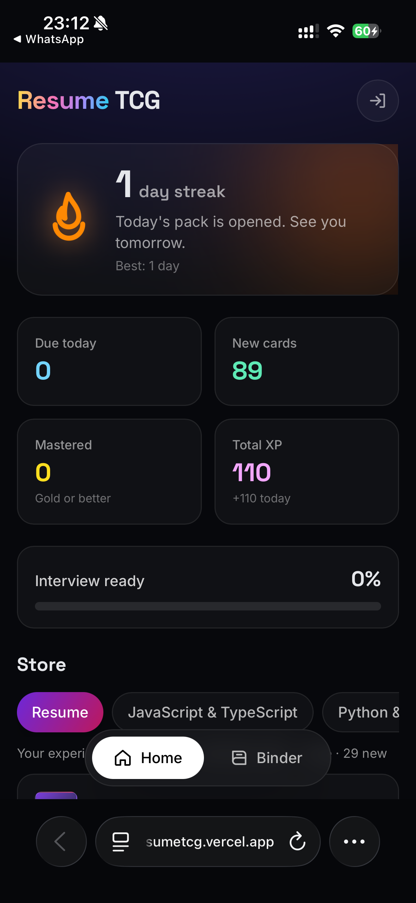
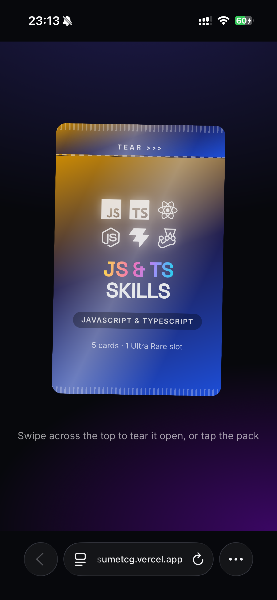
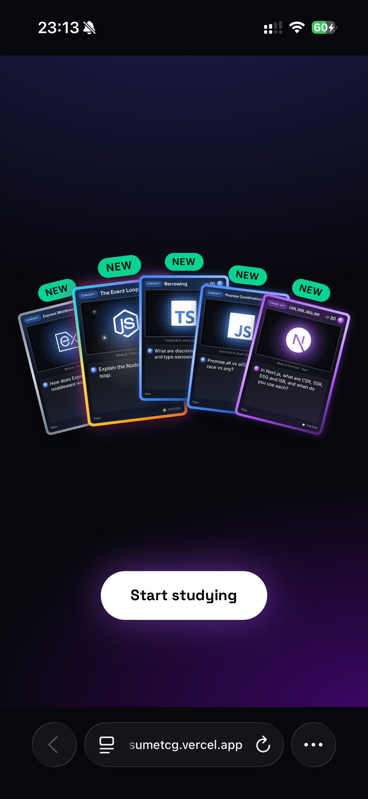
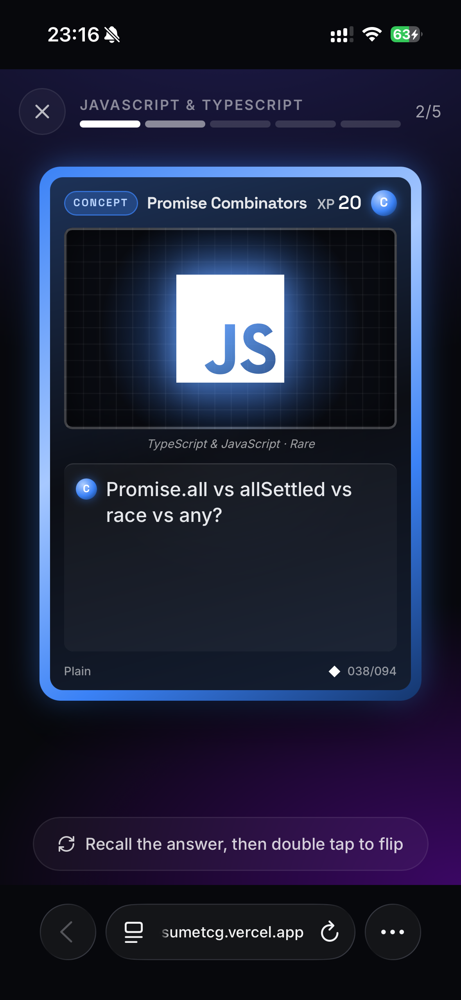
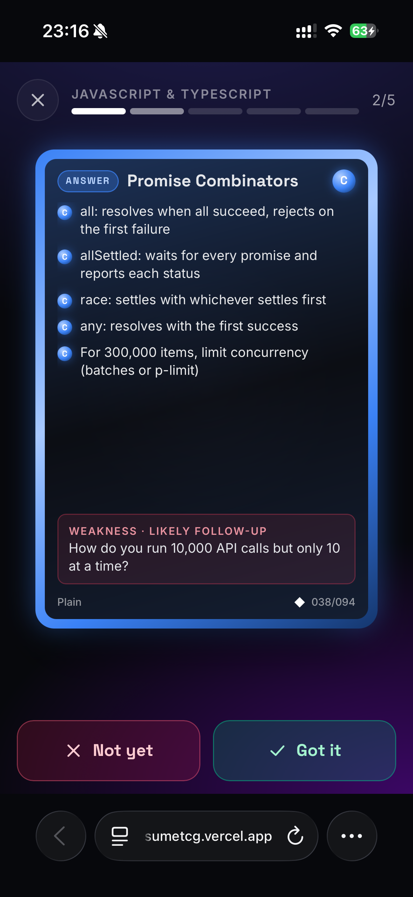
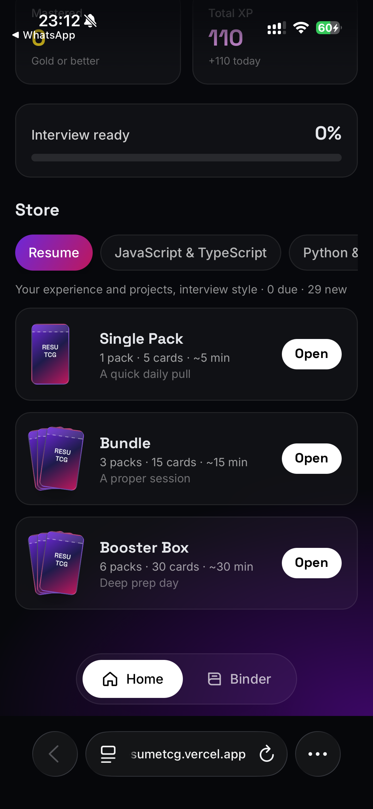
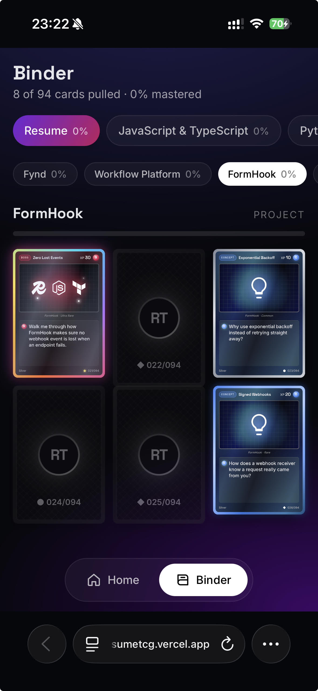
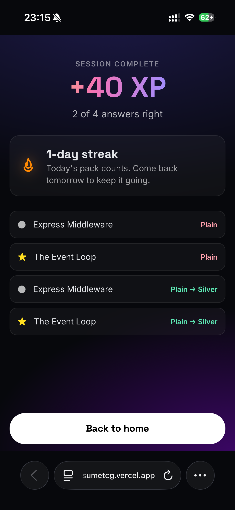
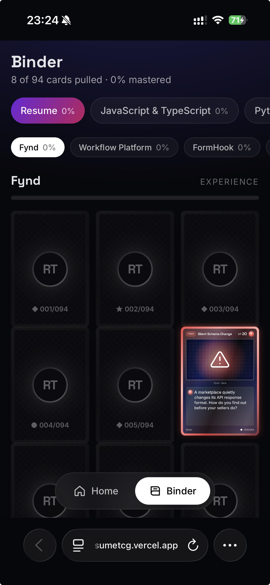

# Resume TCG

**Interview prep as a trading card game.** Every line of a resume becomes a pack of collectible cards: open a booster, recall the answer, flip the card, and level it up from Plain to Full Art as you master it.



## Why

Flashcard apps work, but they are dull, and generic decks do not cover _your_ projects. Resume TCG builds the deck from one resume, so every card is something an interviewer could actually ask, and wraps spaced repetition in the feel of opening Pokémon-style packs.

## How it plays

|                                                                  |                                                                     |
| ---------------------------------------------------------------- | ------------------------------------------------------------------- |
|          |      |
| **Open a pack.** Swipe across the top to tear it.                | **Reveal.** Ten cards flip one by one; the Rare comes last with a flash. |
|  |         |
| **Recall.** Read the question and answer it in your head.        | **Flip and grade.** Double tap, compare, then Got it or Not yet.    |

- **Swipe up** for the next card. Swiping without grading skips the card and changes nothing.
- A card you miss comes back **tomorrow**. The summary lists your misses so you can read them again.
- The back of every card ends with a **Weakness**: the follow-up question an interviewer is likely to ask next. Every Weakness is also a card of its own: its **EX** version (see below).

### Packs and sets

Like a real booster, every pack holds **10 cards in fixed slots**:

| Slots        | What goes in                                                                       |
| ------------ | ---------------------------------------------------------------------------------- |
| 4 × Common   | Easy cards: due reviews first, then new cards                                      |
| 3 × Uncommon | Medium cards, the same way                                                         |
| 2 × Review   | Cards you have seen before that are due, of any rarity, with a reverse-holo shine |
| 1 × Rare     | A hard card. One pack in five it is an **EX** instead, once you have unlocked any  |

You choose how much to study by how much you open:

| Product     | Packs | Cards | Time    |
| ----------- | ----- | ----- | ------- |
| Single Pack | 1     | 10    | ~10 min |
| Bundle      | 3     | 30    | ~30 min |
| Booster Box | 6     | 60    | ~60 min |

Every pack comes from one **set**. There is one set for the resume itself, and one per skill group, where each group gathers the skills that belong together:

| Set                            | Covers                                                                                                     | Cards |
| ------------------------------ | ---------------------------------------------------------------------------------------------------------- | ----- |
| **Resume**                     | Fynd, Workflow Platform, FormHook, behavioral stories, and this app (Built With)                           | 41    |
| **JavaScript & TypeScript**    | TypeScript, JavaScript, React, Next.js, Vue, Redux, Tailwind, Node.js, Express, Vite, Webpack, Jest, Mocha | 40    |
| **Python & ML**                | Python, NumPy, pandas, scikit-learn, PyTorch, deep learning, retrieval, model serving                      | 40    |
| **Data & Databases**           | SQL, PostgreSQL, MySQL, MongoDB, Sequelize, Mongoose                                                       | 41    |
| **APIs & Distributed Systems** | REST, OpenAPI, OAuth 2.0, WebSockets, microservices, event-driven design, Kafka, Temporal, BullMQ, Redis   | 40    |
| **Cloud & DevOps**             | Docker, Kubernetes, Helm, Terraform, Google Cloud, AWS, CI/CD, Git, Bash                                   | 40    |
| **Quality & Observability**    | Testing, contract testing, OpenTelemetry, Grafana, SLOs, incidents                                         | 40    |

Each set mixes quick-recall syntax cards (what does `useCallback` do?), concepts, trade-offs, gotchas, debugging scenarios and design questions. A card never repeats within one opening, so a product only appears for a set with enough cards: a Bundle needs 30, a Booster Box 60.



### Rarity is difficulty, foil is mastery

In a normal card game, rare cards are hard to get. Here that is flipped: **harder cards show up more**, not less.

- **Rarity** (● Common, ◆ Uncommon, ★ Rare) is fixed and marks how hard the card is. Every pack is guaranteed a Rare slot.
- **Foil** is earned. Each card sits in a Leitner box from 1 to 5, shown as **Plain, Silver, Gold, Holo, Full Art**. Got it moves the card up a box, but **only when the card was due**: answering early is practice, with no foil change and no XP. Not yet sends it back to Plain.
- Foils never change during a pack. Promotions are revealed on the summary, and you see the new foil the next time you pull the card.
- **Full Art** shows the technology's real logo in full color across the whole card, and the card takes on the brand's colors.
- Harder rarities wait less between reviews, so you see them more often:

| Foil     | Common  | Uncommon | Rare    |
| -------- | ------- | -------- | ------- |
| Plain    | 1 day   | 1 day    | 1 day   |
| Silver   | 2 days  | 1 day    | 1 day   |
| Gold     | 5 days  | 3 days   | 2 days  |
| Holo     | 14 days | 7 days   | 4 days  |
| Full Art | 30 days | 21 days  | 10 days |

### EX cards

Every card has an **EX** twin. Its question is the original card's Weakness, and its back holds that answer, so EX cards are the follow-ups an interviewer asks next.

- An EX unlocks once its base card reaches **Gold**: you should know the answer before you get the follow-up.
- After that, the Rare slot has a 1 in 5 chance of being one of your unlocked EX cards, with its own reveal.
- EX cards have a chrome frame, a full-color logo that bursts out of the art, and 50 XP. They level up on their own foils.



### Progress

- **Streak:** open at least one pack a day (in your local time zone).
- **XP:** 10, 20 or 30 per counted correct answer, by rarity, and 50 for an EX.
- **Interview ready:** the share of cards at Gold or better.
- **Binder:** your collection per stack. Cards you have not pulled yet stay face down.

|                                                  |                                        |
| ------------------------------------------------ | -------------------------------------- |
|  |  |

## Tech stack

| Layer              | Choice                                                 |
| ------------------ | ------------------------------------------------------ |
| Front end          | React 19, TypeScript, Vite                             |
| Styling and motion | Tailwind CSS 4, Motion (card flip, tilt, pack tearing) |
| Back end           | Supabase: Postgres, Row Level Security, Auth           |
| App shell          | PWA (installable, full screen on a phone)              |

The game logic lives in Postgres functions rather than the client:

- `open_packs(packs, tz, set)` fills the 10 slots: due cards first, then new cards hardest first, review slots from seen cards, and the EX roll for the Rare slot
- `record_answer(card, got_it, tz)` moves the card between boxes only when it was due, schedules the next review and logs XP
- `get_home(tz)` returns the streak (a gaps-and-islands query), due counts and per-set stats in one call

Every table has RLS, so each user only ever sees their own progress.

## Running it locally

```bash
cd app
npm install
npm run dev
```

Create `app/.env.local`:

```bash
VITE_SUPABASE_URL=https://<project-ref>.supabase.co
VITE_SUPABASE_PUBLISHABLE_KEY=sb_publishable_...
# true: email sign-in, progress shared across devices. false: anonymous, one browser only.
VITE_AUTH_ENABLED=true
```

Set up the database by running, in order:

1. `app/supabase/migrations/20261027000000_cards_progress_packs.sql`
2. `app/supabase/migrations/20261028000000_card_sets.sql`
3. `app/supabase/migrations/20261028120000_ten_card_packs_and_ex.sql`
4. `app/supabase/seed.sql`

In the Supabase dashboard, set the Site URL (Authentication, URL Configuration) to where the app runs, so sign-up confirmation links land in the right place. With `VITE_AUTH_ENABLED=false`, turn on anonymous sign-ins instead (Authentication, Sign In / Providers).

## Editing the deck

All card text lives in [`app/src/data/cards.json`](app/src/data/cards.json): sets, stacks and cards.

- Each card has a question, key points, optional `code` and `answer` snippets, a `weakness`, and an `ex` block that answers the weakness.
- Changing text needs nothing else.
- Adding, removing or changing the rarity of cards: run `npm run seed:build` (it validates the deck and rewrites `supabase/seed.sql`), then run the seed against the database.
- Keep card ids stable. Progress is stored per id.
- Open **`/#deck`** to see every card front and back, and **`/#preview`** for the EX and Full Art designs. Neither needs sign-in.

## Project layout

```
app/
  src/
    data/cards.json        the deck
    components/TcgCard.tsx the card: layout, flip, tilt, foils
    screens/               Home (store), PackOpening, StudySession, Summary, Binder, Auth, DeckPreview
    lib/api.ts             calls to the Postgres functions
  supabase/
    migrations/            schema, RLS and functions
    seed.sql               generated card catalogue
  scripts/build-seed.mjs   deck validator and seed generator
```

## Future scope

- **Bring your own resume.** Upload a PDF, parse it, and generate stacks and cards automatically.
- **Review before you play.** A form, like a job application, pre-filled from the parsed resume, where you check and correct the extracted details (roles, dates, metrics, stack) before any cards are generated.
- **Accounts.** Add Google sign-in alongside email.
- **Booster Box for every set.** Grow each set to 60+ cards so a full box never runs dry.
- **Questions from job descriptions.** Paste a job posting and generate cards for anything it asks that the deck does not cover yet.
- **Answer modes.** Type or speak an answer and get AI feedback, plus a timed Mock Interview mode with no flipping.
- **Offline play.** Cache packs and sync answers when you are back online.
- **Card art.** Memes and custom art in the art box, not only logos.
